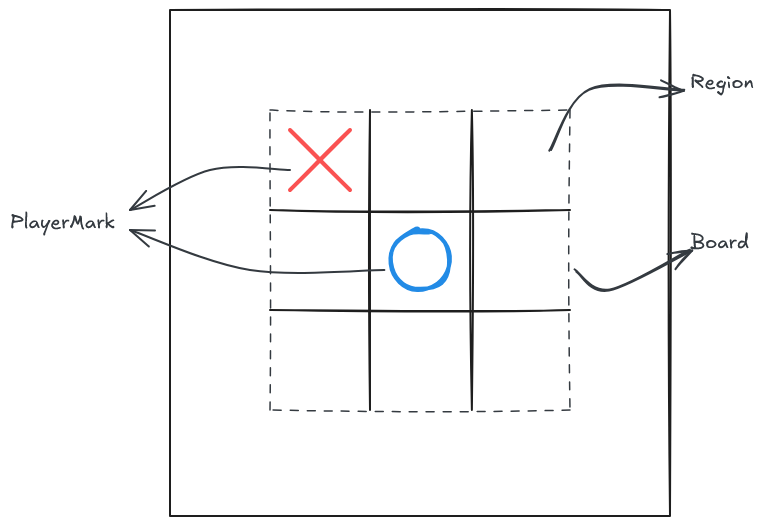

# Tic tac toe

## Stack

- React
- Tailwind

## Files

- assets
- design
- basic

## Design

### Game

Main class. It manage the state of the game and the events related to it

`Game.init()`: Draw the board and configure the game
`Game.next()`

### Player

`Player.pickMark()`
`Player.DrawMark()`

### Board

The main grid it has a property for the 3x3 grid 